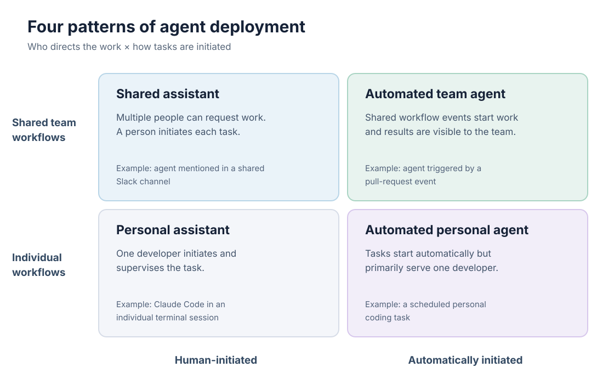
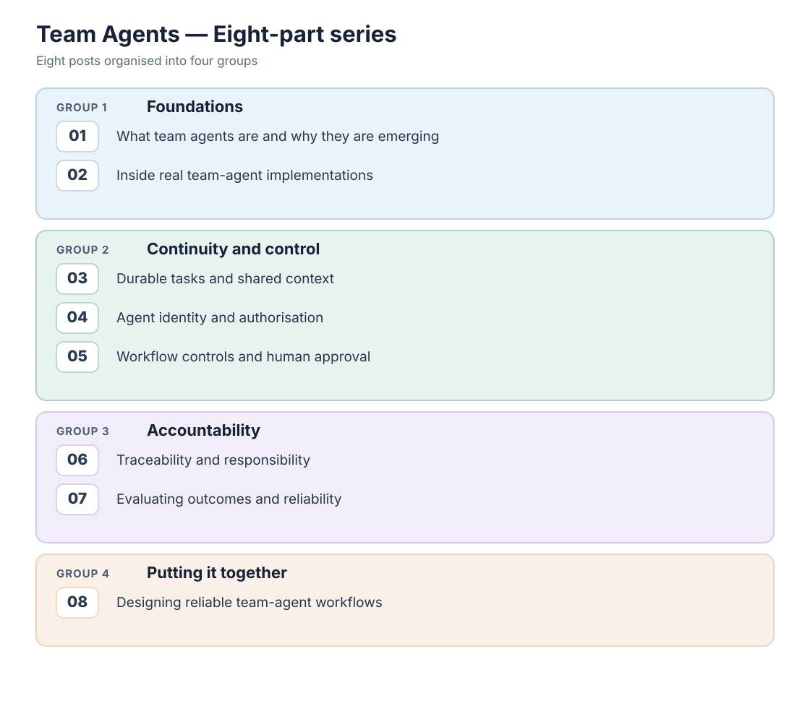

What makes an agent a team agent is not the AI model it uses, but how it works with a team. Team agents can take on shared tasks, respond to events and continue working across sessions without relying on one developer to coordinate everything. But making agents available to a team is not enough. They need continuity, control and accountability to become a reliable part of the team's workflow.

For many developers, coding agents started as personal assistants. You open your editor or terminal, describe a task, let the agent work on it, and review the results.

Since mid-2025, that picture has been changing. Companies such as Shopify, Ramp, Stripe, Anthropic, OpenAI and GitHub have been bringing coding agents into team workflows, including Slack channels, issue trackers and pull requests. Some have also introduced agents that can work across shared workspaces and handle tasks without constant human supervision. Coding agents are no longer limited to assisting individual developers; they are becoming part of how software teams work.

This series explores two related questions: what makes an agent a team agent, and what does it take to make it a reliable part of a software team?

This first post covers four questions:

1. What is a team agent?
2. How does it differ from a personal coding agent?
3. What are the limitations of personal agents, and why are team agents emerging now?
4. What does a team agent need to operate reliably within a software team?

The final question also sets up the seven posts that follow.

## What is a team agent?

A team agent is an AI agent that works as part of a software team's shared workflows, rather than serving only one developer. Team members can assign it tasks, follow its progress and review its work without relying on one person's conversation to maintain the context. The distinction is not the number of agents: one agent can serve an entire team, while five agents working for one developer are still personal agents.

In practice, team agents introduce three important characteristics:

- **Multiple people can direct them.** Team members can assign tasks or provide instructions to the same agent. These requests may conflict, raising questions about who has the authority to direct its work.
- **Event-driven work.** Repository events, issue assignments, mentions or schedules can trigger an agent to start working. Personal agents can also be event-driven. The difference is that team agents can respond to events in shared workflows without relying on one developer to initiate or coordinate every task.
- **Durable tasks.** Work can continue across sessions, systems and handovers. The agent needs to retain task state and context so that progress is not lost when a session ends or someone else takes over.

Teams can work with an agent in ways similar to working with another team member. They can mention it in a shared channel, assign it an issue, or have an automated event trigger a task. The agent then produces results in the team's existing tools, such as pull requests, issue trackers or channel discussions, where other team members can review and follow up on its work.

However, working with an agent is not the same as working with a human colleague. Human colleagues exercise professional judgment, carry organisational responsibilities and are accountable for their decisions. Agents operate within permissions, instructions and controls established by people.

The industry has not settled on a name. Shopify and Anthropic describe their agents as "multiplayer", allowing multiple people to interact with the same agent. OpenAI uses the term "workspace agents" for agents shared across teams. Ramp's Inspect combines multiplayer collaboration with background execution, while Stripe describes its Minions as unattended coding agents. GitHub allows developers to assign issues directly to its Copilot coding agent.

These terms describe different but overlapping capabilities. An agent running in the background, for example, is not necessarily a team agent. In this series, I use "team agent" to emphasise what matters most: the agent works as part of a team's shared workflows rather than serving only one developer.

## Personal agents vs team agents

The main difference is how agents participate in software development workflows. Personal agents primarily support individual developers, while team agents work within shared workflows where multiple people can direct, review and continue their work.

| Dimension | Personal agent | Team agent |
|---|---|---|
| Who directs it | Primarily one developer | Multiple team members, sometimes with conflicting instructions |
| What starts work | Developer prompts, events or scheduled tasks | Shared workflow events, assignments, mentions or schedules |
| Where context lives | Individual sessions or personal workspaces | Shared task state and systems accessible to the team |
| How work continues | Usually coordinated by one developer | Can continue across sessions and team handovers |
| Who reviews the results | Primarily the developer using the agent | Team members, supported by automated checks and approval rules |
| Blast radius | Depends on the developer's access and permissions | Can affect shared repositories, systems and other team members |
| Examples | Copilot in an IDE, Cursor, Claude Code in a personal session | Shopify River, Ramp Inspect, Stripe Minions, Anthropic Claude Tag, OpenAI workspace agents |

Two dimensions help explain how agents are deployed: who can direct their work and how tasks are initiated. Together, they give us four common deployment patterns.

{#fig-agent-deployment width="100%" fig-alt="Four-quadrant agent deployment matrix. Human-initiated personal assistant, automatically initiated personal agent, human-initiated shared assistant, and automated team agent."}

Moving up the diagram means the agent works within shared team workflows rather than primarily serving one developer. Moving right means tasks can start automatically instead of requiring someone to initiate each run. Both changes affect how teams coordinate work, control agent actions and assign responsibility for the results.

The same product can operate in more than one quadrant, depending on how it is deployed. Claude Code running in a developer's terminal is typically a personal agent. Anthropic's earlier Claude in Slack integration allowed developers to interact with Claude in shared channels, but access was tied to individual users rather than a shared agent identity. This provided a shared interface without making the agent a shared team resource.

Claude Tag takes a different approach. It operates as a shared agent within a Slack channel, using its own identity and administrator-configured access to tools and repositories. It also retains memory across conversations, allowing team members to continue work started by others. This shows why deployment matters more than the underlying AI model. When agents become part of shared workflows, teams must decide who can direct them, what they are allowed to do and who is responsible for the results.

## Limitations of personal agents

Personal coding agents can help individual developers work more efficiently. However, when agents operate mainly within personal workflows, the knowledge and context from their work may not be readily available to the rest of the team. Coordination between developers also remains largely a human responsibility. These limitations become more apparent when teams try to extend agent-assisted development beyond individual developers.

### 1. Knowledge stays with individual developers

When developers use coding agents in private sessions, the knowledge generated during those sessions may not be shared with the rest of the team. Other developers may not know what problems were encountered, how they were resolved or why particular decisions were made. As a result, teams may repeat investigations or lose useful context when similar problems arise.

Shopify took a different approach with River, its internal coding agent. River works only in public Slack channels, where employees can observe its work, contribute suggestions and reuse solutions. Shopify reports that River's merge rate for pull requests targeting production increased from 36% to 77% over two months. During this period, developers documented problems and solutions as shared skills and instructions that River could use in later sessions. Shopify attributes much of the improvement to this collective learning, although the company has not established how much of the increase resulted from shared knowledge rather than other changes.

### 2. Context is fragmented across sessions and tools

Personal coding agents often rely on the context available in an individual session. However, important information may be spread across issue trackers, pull-request discussions, project documentation and previous agent sessions. When an agent starts a new session, it may not automatically have access to earlier decisions, changes in requirements or the reasoning behind previous work. Developers then have to reconstruct this context or provide it again before the agent can continue.

This limitation also affects agents designed for team workflows. For example, GitHub's Copilot coding agent receives an issue's description and existing comments when it is assigned. However, it does not automatically receive comments added to the issue afterward. Developers must provide follow-up instructions through the pull request created by the agent, where they can mention `@copilot` to request further changes.

### 3. Coordination still depends on people

Personal coding agents can help developers complete implementation tasks faster, but the handoffs, reviews and approvals around that work still depend largely on people. A developer may produce code more quickly, but someone still needs to review the changes, resolve integration issues and coordinate with other team members. Making one part of the workflow faster can simply move the bottleneck to the next stage, without improving the team's overall productivity.

### Team agents are not automatically better

Moving from personal agents to team agents does not automatically solve these limitations. Shared workflows can make knowledge more accessible, help preserve task context and support coordination between developers. However, they also introduce new challenges. Multiple people may give conflicting instructions, agents may need access to shared systems, and their work may require additional review and oversight. Whether team agents improve software development depends on how teams design and manage these workflows.

## Why now?

Since 2025, team agents have moved beyond experimental tools into real software development workflows. Companies such as Shopify, Ramp, Stripe, Anthropic, OpenAI and GitHub have introduced or documented different approaches to using agents in shared team workflows. The following timeline highlights key developments that illustrate this shift.

**Key developments in team-agent workflows (2025–2026)**

| Date | Development |
|---|---|
| Sep 25, 2025 | **GitHub:** Copilot coding agent becomes generally available, allowing developers to assign issues and have an agent create pull requests in the background. |
| Jan 12, 2026 | **Ramp:** Publishes how Inspect supports background coding, verification and collaboration across developers. |
| Feb 9, 2026 | **Stripe:** Describes Minions, its unattended coding agents, reporting more than 1,000 agent-produced pull requests merged each week after human review. |
| Apr 22, 2026 | **OpenAI:** Introduces workspace agents that teams can share and use for repeatable workflows across different tools. |
| May 28, 2026 | **Shopify:** Publishes how River works in shared Slack channels, reporting 3,536 River-coauthored pull requests merged over 30 days. |
| Jun 23, 2026 | **Anthropic:** Launches Claude Tag, enabling multiple people to work with a shared agent in a Slack channel. |

These developments show how coding agents are moving into shared software development workflows. Teams can assign agents issues, interact with them in shared channels and review their work through pull requests. Some agents can also continue working in the background without constant human supervision. Although companies such as Shopify and Stripe report substantial agent-assisted development activity, these figures come from the companies themselves and do not establish whether team agents consistently improve software development outcomes.

## What does a team agent need to operate reliably?

A team cannot rely on an agent's capabilities alone. When agents become part of shared workflows, teams need ways to maintain work across sessions, control what agents are allowed to do and establish who is responsible for the results. These requirements are not unique to team agents, but they become more important when multiple people interact with the same agent and its actions affect shared systems. I group them into three areas: continuity, control and accountability.

Consider a team agent working on a new feature. It implements the changes, runs the tests and opens a pull request. The tests pass, but the change still requires a security review. The reviewer requests changes, another developer modifies a related component, and the product owner updates a requirement.

The agent now needs to handle feedback and changes from several people while keeping track of what has already been done. In a personal-agent workflow, one developer would typically coordinate these activities and guide the agent. In a team-agent workflow, different people may interact with the agent directly, so the workflow needs to preserve task context, control what the agent can do and make responsibility for decisions clear.

| Pillar | Key question | Example mechanisms |
|---|---|---|
| **Continuity** | How does the agent retain context and continue work across sessions, interruptions and handovers? | Persistent task state, checkpoints and shared work history |
| **Control** | Who can direct the agent, what actions can it perform and which decisions require human approval? | Agent identity, access permissions, branch protection and required approvals |
| **Accountability** | Can teams understand what the agent did, who authorised its actions and whether the work produced useful results? | Action logs, decision records, traceability and outcome metrics |

The rest of the series explores how teams can address these requirements. We'll first examine real team-agent implementations, then look at continuity, control and accountability in more detail, before bringing everything together in the final post.

{#fig-series-roadmap width="100%" fig-alt="Four groups: Foundations, Posts 01–02; Continuity and control, Posts 03–05; Accountability, Posts 06–07; Putting it together, Post 08."}

Continue with [Part 2: Inside Real Team Agents](../team-agents-part-2/index.qmd) — how Shopify, Ramp, Stripe, Anthropic, OpenAI and GitHub have implemented team-agent workflows, and what their reported results can and cannot tell us.

## Related posts

- [Context Is Not Enough: Why AI Agents Need a Harness](../context-is-not-enough-why-ai-agents-need-a-harness/index.qmd)
- [When AI Writes Code Faster Than We Can Review It](../when-ai-writes-code-faster-than-we-can-review-it/index.qmd)

## References

- [Shopify Engineering — *Under the River*](https://shopify.engineering/under-the-river)
- [Shopify — *Zero Experience, Infinite Leverage*](https://internships.shopify.com/pages/zero-experience-infinite-leverage)
- [Ramp Engineering — *Why We Built Our Own Background Agent*](https://engineering.ramp.com/post/why-we-built-our-background-agent)
- [Stripe — *Minions: Stripe's One-Shot, End-to-End Coding Agents*](https://stripe.dev/blog/minions-stripes-one-shot-end-to-end-coding-agents)
- [Anthropic — *Introducing Claude Tag*](https://www.anthropic.com/news/introducing-claude-tag)
- [Anthropic — *What Is Claude Tag?*](https://support.claude.com/en/articles/15594475-what-is-claude-tag)
- [OpenAI — *Introducing Workspace Agents in ChatGPT*](https://openai.com/index/introducing-workspace-agents-in-chatgpt/)
- [GitHub — *Copilot Coding Agent Is Now Generally Available*](https://github.blog/changelog/2025-09-25-copilot-coding-agent-is-now-generally-available/)
- [GitHub Docs — *Kick Off a Task with Copilot Agents*](https://docs.github.com/en/copilot/how-tos/copilot-on-github/use-copilot-agents/kick-off-a-task)
